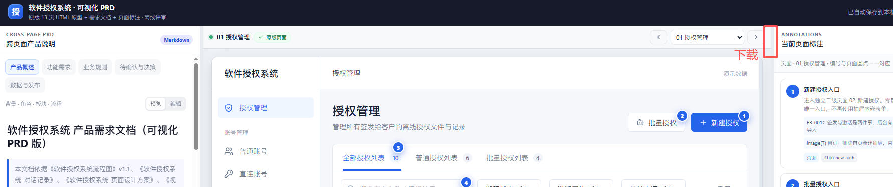
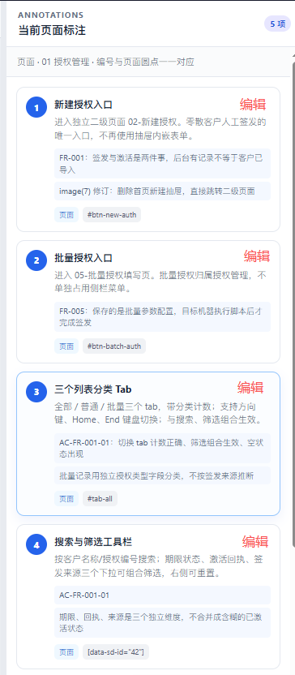
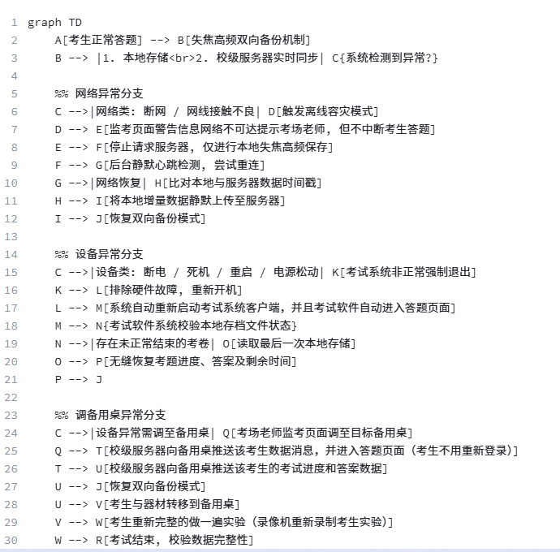
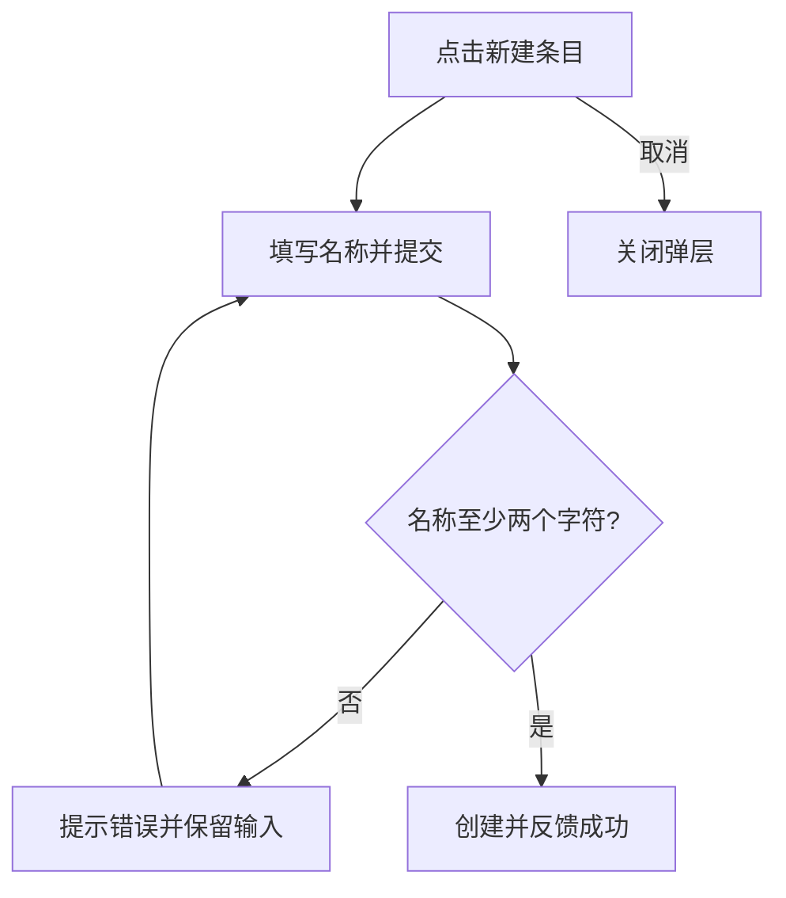

# 可视化 PRD · Visual PRD

把产品说明、可交互 HTML 原型和页面标注放在同一个离线网页中，支持本地修改、授权后自动写回 HTML，以及导出供前端继续开发的页面。

**当前版本：2.2.0。** 本仓库提供可复用的 `visual-prd` 技能、容器模板、构建脚本和完整演示。流程图使用可读的 **Mermaid Markdown 源码**：编辑节点和连线，预览时自动生成图，并保留配套的流程文字说明。

- [下载技能压缩包](dist/visual-prd-2.2.0.zip)
- [下载离线演示 HTML](examples/visual-prd-demo.html)（下载到本地后用浏览器打开）
- [查看技能说明](visual-prd/SKILL.md)
- [查看流程图示例源码](examples/flows.md)

> GitHub 的文件预览展示 HTML 源码。体验交互请下载 HTML 文件，或克隆仓库后在本地打开；本仓库没有配置在线演示站点。

## 主要功能

| 功能 | 使用方式与结果 |
| --- | --- |
| 三栏评审 | 左侧跨页面产品说明，中间交互原型，右侧当前页面标注 |
| 标注联动 | 原型圆点和右侧卡片使用同一编号；点击卡片可定位对应标注 |
| 逐条编辑 | 每条标注有编辑按钮，可修改标题、Markdown 正文和业务规则 |
| 粘贴图片 | 文档和标注编辑区支持粘贴位图，图片随完整评审 HTML 保存 |
| 流程图编辑 | 产品概述后有“流程图”章节，使用 Mermaid 源码编辑，离线渲染 SVG |
| 流程文字说明 | 每张图说明入口、角色、步骤、分支、异常处理与结果；数据流补充来源和更新触发 |
| 独立栏位开关 | “关闭/开启产品说明”和“关闭/开启页面标注”独立控制左右栏，释放原型空间 |
| 自动写回磁盘 | 浏览器授权目标 HTML 后，后续修改自动写入该文件 |
| 当前页下载 | 翻页按钮旁的“下载”以当前页面为默认入口生成 HTML |
| 全部页面下载 | 顶部“下载全部页面”生成 ZIP，每个页面一个 HTML，保留业务交互 |
| 离线交付 | 文档、原型运行时、图片与 Mermaid 库内嵌到最终文件中 |

## 界面与格式参考截图

以下四张图来自项目需求阶段提供的参考截图，用于说明布局、按钮位置和流程图编辑格式，**不是本仓库演示页面的实机截图**。图中的“软件授权系统”是布局参考；仓库附带的可运行示例为“条目管理”，包含列表、详情和创建弹层。

### 三栏布局与当前页面下载位置



左侧文档与右侧标注围绕原型展示；当前页面的下载入口位于翻页控件右侧。

### 每条标注的编辑入口



当前模板为每条标注提供真实编辑按钮，点击后编辑标题、正文与业务规则；正文可粘贴图片。

### 顶部栏位开关与全部下载


这张图中的红字是需求位置标注。当前模板已实现对应按钮及开关状态变化。

### 流程图使用可读源码



编辑区保留 `graph TD`、节点、连线、条件和注释；预览区渲染成流程图。不会用长串 base64 图像数据替代可编辑的流程源码。

## 快速体验

1. 下载 [演示 HTML](examples/visual-prd-demo.html)，或克隆仓库。
2. 用桌面 Chrome 或 Edge 打开 `examples/visual-prd-demo.html`。
3. 在中间原型点击“查看示例详情”“返回列表”“新建条目”，体验页面跳转和表单校验。
4. 点击右侧标注的“编辑”修改文字或粘贴图片。
5. 左侧点击“流程图 → 编辑”修改源码和说明，点击“预览”查看结果。
6. 点击顶部“授权自动写回”，选择目标 HTML。确认显示“已自动写回”后，修改才真正保存在磁盘中。
7. 使用“下载”或“下载全部页面”交付开发页面。

只看演示不需要 Python、Node.js 或安装依赖。演示是前端原型，没有接入后端业务服务。

## 作为技能使用

将 `visual-prd/` 整个目录放入所用工具的技能目录，或向支持读取 `SKILL.md` 的助手明确提供该目录。请保留 `assets/`、`scripts/` 和 `references/`；只复制 `SKILL.md` 无法构建完整网页。

可以使用这样的任务描述：

```text
请使用 visual-prd 技能，为条目管理系统生成可视化 PRD。
包含列表、详情、新建条目和校验失败流程。
需要产品说明、逐条页面标注，以及带文字解释的 Mermaid 流程图。
最终交付可离线打开的 HTML，支持授权自动写回，
并可下载不含产品说明和标注的交互页面。
尚未确认的业务规则请标记为“待确认”。
```

技能中的工作流覆盖需求澄清、板块规划、逐板块 PRD 与原型生成、交互自检及最终装配。任务已明确的部分可以直接使用现有需求；具体业务规则仍应来自已确认的产品信息。

## 目录结构

```text
keshihua_PRD/
├── README.md
├── visual-prd/
│   ├── SKILL.md                    技能入口与验收要求
│   ├── assets/
│   │   ├── container-template.html  评审容器模板
│   │   ├── prototype-template.html  交互原型骨架
│   │   ├── container-styles.css     拆分开发时的样式参考
│   │   ├── mermaid.min.js           离线流程图渲染库
│   │   └── mermaid-LICENSE.txt      Mermaid 许可
│   ├── scripts/
│   │   ├── build-container.py       装配单文件 HTML
│   │   ├── prototype-runtime.js     路由、状态和表单运行时
│   │   ├── annotation-runtime.js    标注运行时
│   │   ├── check-interactions.js    静态交互检查
│   │   ├── validate-package.py      技能包与烟雾构建校验
│   │   └── package-skill.py         版本化 ZIP 打包
│   └── references/                 PRD、标注、渲染及交付指南
├── examples/
│   ├── prototype-source.html       演示原型输入
│   ├── prd.md                      演示产品说明输入
│   ├── annotations.json            演示标注输入
│   ├── flows.md                    可编辑流程图输入
│   └── visual-prd-demo.html         已构建的离线演示
├── dist/
│   └── visual-prd-2.2.0.zip         可分发技能压缩包
└── docs/
    ├── screenshots/                需求参考截图
    └── verification-2.2.md         流程图修改验证记录
```

## 从源码构建

构建环境使用 **Python 3.10+** 和 **Node.js 18+**。Python 脚本使用标准库，Node.js 用于静态交互和语法检查；无需 `npm install`。Mermaid 11.16.0 已随技能内附。

```bash
git clone https://github.com/lanyuxi/keshihua_PRD.git
cd keshihua_PRD

python3 visual-prd/scripts/validate-package.py
node visual-prd/scripts/check-interactions.js examples/prototype-source.html

python3 visual-prd/scripts/build-container.py \
  --prototype examples/prototype-source.html \
  --prd examples/prd.md \
  --annotations examples/annotations.json \
  --flows examples/flows.md \
  --prototype-output build/prototype.html \
  --output build/visual-prd.html
```

构建脚本会创建输出目录：

- `build/visual-prd.html`：完整评审文件，含产品说明、流程图、标注与交互原型。
- `build/prototype.html`：独立的带标注原型，用于检查原型运行时；它与容器里的“开发页面下载”用途不同。

`build/` 已加入 `.gitignore`，避免临时构建覆盖仓库中预先生成的演示。

### 四类输入

| 输入 | 内容 | 对应指南 |
| --- | --- | --- |
| 原型 HTML | 页面定义、稳定锚点、状态、路由、弹层和事件 | [原型骨架](visual-prd/assets/prototype-template.html) |
| PRD Markdown | 产品概述、需求、业务规则、验收条件等 | [PRD 模板](visual-prd/references/prd-template.md) |
| 标注 JSON | 稳定 ID、顺序、页面、正文、业务规则和作用域 | [标注指南](visual-prd/references/annotation-guide.md) |
| 流程 Markdown | Mermaid 代码块和逐图的文字说明 | [编辑与导出指南](visual-prd/references/editing-and-export.md) |

### 标注示例

原型中的锚点：

```html
<button type="button" data-action="open-modal:create"
        data-anno="template-create">新建条目</button>
```

标注数据：

```json
{
  "id": "template-create",
  "order": 2,
  "pageId": "list",
  "title": "创建入口",
  "body": "点击打开创建表单。",
  "businessRules": ["名称至少两个字符"],
  "scope": { "type": "page", "id": "list" }
}
```

`id` 与 `data-anno` 必须一一对应，`order` 是原型圆点和卡片编号的共同来源。同一可见视图中的编号应从 1 连续排列；上述第二条标注与示例 JSON 中的第一条配套使用。

### 流程图 Markdown 示例

以下内容可直接放入 `flows.md` 或粘贴到流程图编辑区：

````markdown
## 创建条目流程

入口：用户在列表点击新建。填写名称后提交。
名称不符合要求时保留输入并提示错误；校验通过后创建并反馈成功。
取消只关闭弹层，不创建条目。


````

业务流程、核心功能流程与数据流分别配套文字说明。数据流还应解释数据来源、传递方向、更新触发及失败处理；未接入实时服务时，不应把静态图描述为已经连接实际实时系统。

## 编辑与永久保存

完整评审 HTML 中，文档编辑区保存 Markdown 原文，标注编辑区保存标题、正文和业务规则。预览 HTML/SVG 是派生结果，不会反写覆盖流程源码。

保存分为两层：

| 状态 | 含义 |
| --- | --- |
| 浏览器草稿 | IndexedDB 用于恢复未完成的编辑；不代表磁盘 HTML 已更新 |
| 已自动写回 | 所选 HTML 的写入流已成功关闭，编辑内容已经写入磁盘文件 |

首次使用时点击“授权自动写回”，在浏览器文件选择器中选择当前 HTML 或一个新副本。停止输入约 320 ms 后触发自动保存，写入串行执行。顶部状态显示所选文件名。

- 选择新副本后，之后自动更新的是该副本，不会同时更新最初打开的文件。
- HTML 内嵌文档、标注、图片与保存状态；复制到其他路径后仍能恢复内容。
- 重开后浏览器可能要求重新授权写入；权限失效时按提示点击授权入口。
- 未写回就关闭页面会提示；取消、拒绝授权或写入失败不会显示保存成功。
- 不支持文件授权接口时只能下载完整评审副本，不能实现自动写回。

文件授权接口的说明见 [Chrome 官方文档](https://developer.chrome.com/docs/capabilities/web-apis/file-system-access)。只需选择你确实希望被自动更新的 HTML 文件。

## 给前端交付页面

“下载”和“下载全部页面”使用独立的业务源码生成开发文件，排除产品说明、流程图文档、页面标注、标注圆点及标注运行时。

| 入口 | 产物 |
| --- | --- |
| 翻页右侧“下载” | 一个 HTML，以当前页面为默认入口 |
| 顶部“下载全部页面” | 一个 ZIP，包含全部注册页面各自的 HTML |

每个导出 HTML 保留共享页面定义、样式和业务处理器，因此列表到详情、返回、弹层和表单等交互仍可运行。不同文件的默认入口不同，并非把页面裁剪成互不连通的截图。文件中演示的是原型业务状态；真实接口和生产功能仍由开发人员按需求接入。

当前示例有两页，全部下载会得到 `01-list.html` 与 `02-detail.html`。原型页面应在初始化 DOM 中注册，尚未访问的页面也能被发现并导出。

## 验证与打包

```bash
# 校验目录、脚本语法、交互声明与烟雾构建
python3 visual-prd/scripts/validate-package.py

# 检查实际原型里的交互点
node visual-prd/scripts/check-interactions.js examples/prototype-source.html

# 按 SKILL.md 中的版本生成分发包
python3 visual-prd/scripts/package-skill.py \
  --output dist/visual-prd-2.2.0.zip
```

静态检查通过后，还应在真实浏览器中操作导航、弹层、输入、校验、标注编辑和下载。验证磁盘保存时，检查实际文件并从新路径重开，避免只验证了浏览器草稿。

本次 2.2 流程图验证覆盖源码编辑、离线渲染、语法错误恢复、修改后自动写回、新路径重开、过期渲染防护和导出边界。详情见 [验证记录](docs/verification-2.2.md)。没有把未重新执行的完整原型交互测试描述为本次已经全部通过。

## 常见问题

**编辑后重新打开原 HTML，为什么看不到修改？** 先确认顶部显示“已自动写回”，再核对写回文件名。如果选择了新副本，请打开那个副本；仅有“草稿已存”表示磁盘文件尚未更新。

**为什么流程图预览显示源码和错误提示？** 检查围栏语言是否为 `mermaid`，以及节点括号、连线和条件标签是否闭合。修正后再次点击预览；错误不会删除原始源码。

**为什么下载的页面没有左侧说明和右侧标注？** 开发导出只保留业务界面与交互。保存整份评审材料请使用磁盘写回或完整评审副本。

**原型源码可以直接打开吗？** `prototype-source.html` 是构建输入，含运行时注入占位符。请先构建，再打开输出 HTML，或直接使用仓库附带的演示文件。

**可以装入任意第三方网页吗？** 当前容器会读取原型 DOM 以定位标注，只应装入经检查的当前任务原型。信任边界与移植要求见 [安全与可移植性指南](visual-prd/references/security-and-portability.md)。

## 版本与依赖

2.2.0 将流程图编辑源改为可读的 Mermaid Markdown，保留文字说明、离线 SVG 预览与授权自动写回；同时保留逐条标注编辑、左右栏开关、单页下载与全部 ZIP 下载能力。

第三方流程图渲染库为 [Mermaid](https://mermaid.js.org/) 11.16.0，使用随官方包提供的原始库文件，许可见 [mermaid-LICENSE.txt](visual-prd/assets/mermaid-LICENSE.txt)。
