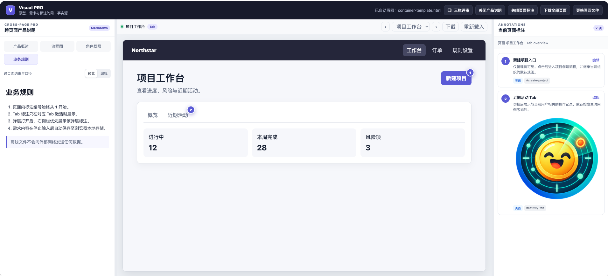
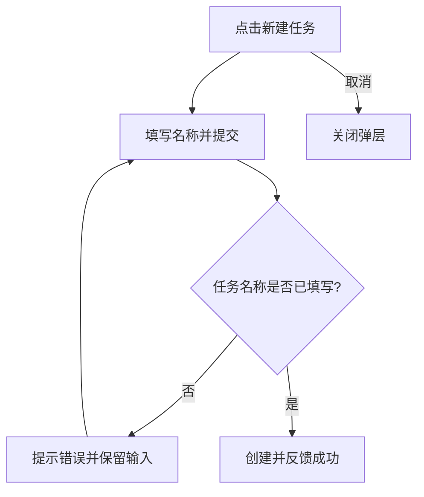

# 可视化 PRD · Visual PRD

把产品说明、可交互 HTML 原型和页面标注放在同一个离线网页中，支持本地修改、授权后自动写回 HTML，以及导出供前端继续开发的页面。

**当前版本：4.1.10。** 本仓库提供可复用的 `visual-prd` 技能、容器模板、构建脚本和完整演示。流程图使用可读的 **Mermaid Markdown 源码**：编辑节点和连线，预览时自动生成图，并保留配套的流程文字说明。

4.1.10 以用户提供的 **`visual-prd-aifanche-4.0.2.zip` 原版包为基础**，保留原版三种工作模式、产品模型、界面规范配置器、需求交接、指标定义和评审模式，再加入 2.2.1 的定制能力及说明栏目、流程图查看需求。2.2.1 是新增能力的来源。

原包文件名及发布元数据标为 4.0.2，包内技能正文标为 4.1.4；这是原包自带的标注差异。4.1.10 是本仓库的增强版本，原包 `_meta.json` 保留原样。兼容复核见 [4.1.10 验证记录](docs/verification-4.1.10.md)。

- [下载技能压缩包](dist/visual-prd-4.1.10.zip)
- [下载离线演示 HTML](examples/visual-prd-demo.html)（下载到本地后用浏览器打开）
- [查看技能说明](visual-prd/SKILL.md)
- [查看流程图示例源码](examples/flows.md)

> GitHub 的文件预览展示 HTML 源码。体验交互请下载 HTML 文件，或克隆仓库后在本地打开；本仓库没有配置在线演示站点。

## 主要功能

| 功能 | 使用方式与结果 |
| --- | --- |
| 三栏／浮动评审 | 三栏同屏与浮动标注之间切换；保留原版按钮行为 |
| 完整说明栏目 | 产品概述、流程图、功能需求、角色权限、业务规则、待确认与决策、数据与发布；材料缺失时显示待补充 |
| 标注联动 | 原型圆点和右侧卡片使用同一编号；点击卡片可定位对应标注 |
| 原型文案编辑 | 中间“编辑”开启后，点击表头、标题、按钮文字、提示等修改；“完成编辑”恢复原交互，修改随 HTML 保存与导出 |
| 逐条编辑 | 每条标注有编辑按钮，可修改标题、Markdown 正文和业务规则 |
| 粘贴图片 | 文档和标注编辑区支持粘贴位图，图片随完整评审 HTML 保存 |
| 流程图编辑 | 产品概述后有“流程图”章节，使用 Mermaid 源码编辑，离线渲染 SVG |
| 流程图查看 | 点击图全屏查看，滚轮缩放 25%–800%，支持下载 PNG |
| 流程文字说明 | 每张图说明入口、角色、步骤、分支、异常处理与结果；数据流补充来源和更新触发 |
| 默认自适应 | 原型外层布局随画布宽度变化，切换模式、关闭栏位或改变浏览器大小后继续适配 |
| 独立栏位开关 | “关闭/开启产品说明”和“关闭/开启页面标注”独立控制左右栏，释放原型空间 |
| 自动写回磁盘 | 选择当前已有 HTML 并授权后，每次修改立即进入写回队列；可点击“立即保存” |
| 当前页下载 | 页面工具栏右侧的“下载”以当前页面为默认入口生成 HTML |
| 全部页面下载 | 顶部“下载全部页面”生成 ZIP，每个页面一个 HTML，保留业务交互 |
| 原版建模与适配 | 装配、增强、生成三种模式；生成模式从单一产品模型派生文档、标注和原型 |
| 界面规范 | 调整生成组件的全局或页面配置，预览并导出 JSON |
| 需求交接与指标 | 按需维护稳定需求 ID、关联验收对象、定义指标与埋点 |
| 草稿兼容 | 升级后读取原版 localStorage 草稿，并与新草稿及 HTML 内嵌状态比较保存时间 |
| 离线交付 | 文档、原型运行时、图片与 Mermaid 库内嵌到最终文件中 |

## 界面截图



这张截图由用户提供，展示左侧跨页面产品说明、中间可交互原型、右侧当前页面标注，以及顶部的栏位开关、页面下载和磁盘写回入口。右侧标注支持文字编辑和图片展示。

图中的“项目工作台”用于展示评审容器的界面；仓库附带的 4.1.10 可运行演示为“任务看板”，包含任务列表、详情标签和创建弹层。截图用于展示容器布局，不是 4.1.10 演示的截图。

## 快速体验

1. 下载 [演示 HTML](examples/visual-prd-demo.html)，或克隆仓库。
2. 用桌面 Chrome 或 Edge 打开 `examples/visual-prd-demo.html`。
3. 在中间原型点击“查看详情”“任务列表”“新建任务”，体验页面跳转和表单校验。
4. 点击右侧标注的“编辑”修改文字或粘贴图片。
5. 左侧点击“流程图 → 编辑”修改源码和说明，点击“预览”查看结果。
6. 点击预览中的流程图全屏查看，使用滚轮缩放或“下载图片”保存 PNG。
7. 点击页面工具栏右侧“编辑”，再点击表头或按钮文字，在就地编辑框修改；点击“完成编辑”恢复原型交互。
8. 点击顶部“授权自动写回”，选择当前正在编辑的已有 HTML，并授予写权限。确认显示“已自动写回”后，修改才真正保存在磁盘中。
9. 使用“下载”或“下载全部页面”交付开发页面。

只看演示不需要 Python、Node.js 或安装依赖。演示是前端原型，没有接入后端业务服务。

## 作为技能使用

将 `visual-prd/` 整个目录放入所用工具的技能目录，或向支持读取 `SKILL.md` 的助手明确提供该目录。请保留 `assets/`、`scripts/` 和 `references/`；只复制 `SKILL.md` 无法构建完整网页。

可以使用这样的任务描述：

```text
请使用 visual-prd 技能，为条目管理系统生成可视化 PRD。
包含列表、详情、新建条目和校验失败流程。
需要产品说明、逐条页面标注，以及带文字解释的 Mermaid 流程图。
最终交付可离线打开的 HTML，支持授权自动写回，
并可下载不含产品说明和标注的交互页面。
尚未确认的业务规则请标记为“待确认”。
```

技能先按已有材料选择最小工作模式：已有 PRD、原型和标注时装配；已有普通 HTML 时在工作副本中增强；只有需求时建立产品模型并生成。未知规则标为待确认，界面规范、需求交接与指标定义按需使用。

## 目录结构

```text
keshihua_PRD/
├── README.md
├── visual-prd/                       完整技能（61 个文件）
│   ├── SKILL.md                      技能入口与兼容边界
│   ├── _meta.json                    保留原包发布元数据
│   ├── assets/                       容器、模型、界面规范模板及 Mermaid
│   ├── scripts/                      构建、校验、运行时及打包脚本
│   └── references/                   三种模式与需求、编辑、交付指南
├── examples/
│   ├── visual-prd.project.json       可重建的项目清单
│   ├── product-model.json            示例任务看板的业务模型
│   ├── ui-profile.json               示例界面规范
│   ├── flows.md                      Mermaid 源码及流程说明
│   ├── prototype-source.html         派生的原型源文件
│   ├── prd.md                        派生的 PRD
│   ├── annotations.json              派生的标注数据
│   └── visual-prd-demo.html           已构建的 4.1.10 离线演示
├── dist/
│   ├── visual-prd-4.1.10.zip           当前可分发技能包
│   ├── visual-prd-4.1.7.zip           历史增强版本
│   ├── visual-prd-4.1.6.zip           历史增强版本
│   └── visual-prd-2.2.1.zip           历史定制版本
└── docs/
    ├── screenshots/visual-prd-overview.png  用户指定的唯一截图
    ├── verification-4.1.10.md          当前紧凑标题栏验证
    ├── verification-4.1.9.md          评审布局精简验证
    ├── verification-4.1.8.md          原型文案编辑验证
    ├── verification-4.1.7.md          自适应与即时保存验证
    ├── verification-4.1.6.md          原版合并及兼容验证
    └── verification-2.2.md            历史流程图验证
```

## 从源码构建

构建环境使用 **Python 3.10+** 和 **Node.js 18+**。Python 脚本使用标准库，Node.js 用于静态交互和语法检查；无需 `npm install`。Mermaid 11.16.0 已随技能内附。

```bash
git clone https://github.com/lanyuxi/keshihua_PRD.git
cd keshihua_PRD

python3 visual-prd/scripts/validate-package.py
python3 visual-prd/scripts/build-review.py examples/visual-prd.project.json

# 兼容旧的直接装配入口
python3 visual-prd/scripts/build-container.py \
  --prototype examples/prototype-source.html \
  --prd examples/prd.md \
  --annotations examples/annotations.json \
  --flows examples/flows.md \
  --prototype-output build/prototype.html \
  --output build/visual-prd.html
```

构建脚本会创建输出目录：

- `build/visual-prd.html`：完整评审文件，含产品说明、流程图、标注与交互原型。
- `build/prototype.html`：独立的带标注原型，用于检查原型运行时；它与容器里的“开发页面下载”用途不同。

`build/` 已加入 `.gitignore`，避免临时构建覆盖仓库中预先生成的演示。

### 三种模式

| 模式 | 输入与结果 |
| --- | --- |
| assemble | 已有 PRD、标注占位原型和标注 JSON，校验后装配 |
| enhance | 已有普通离线 HTML，先在工作副本中建立真实标注及锚点，再增强；保留原有交互 |
| generate | 从 product-model.json 派生 PRD、原型和标注；可附加 ui-profile.json |

所有模式均可通过 `inputs.flows` 指定流程 Markdown。示例项目输出到 `build/`。

### 四类装配输入

| 输入 | 内容 | 对应指南 |
| --- | --- | --- |
| 原型 HTML | 页面定义、稳定锚点、状态、路由、弹层和事件 | [原型骨架](visual-prd/assets/prototype-template.html) |
| PRD Markdown | 产品概述、需求、业务规则、验收条件等 | [PRD 模板](visual-prd/references/prd-template.md) |
| 标注 JSON | 稳定 ID、顺序、页面、正文、业务规则和作用域 | [标注指南](visual-prd/references/annotation-guide.md) |
| 流程 Markdown | Mermaid 代码块和逐图的文字说明 | [编辑与导出指南](visual-prd/references/editing-and-export.md) |

### 标注示例

原型中的锚点：

```html
<button type="button" data-action="open-modal:create"
        data-anno="create-entry">新建任务</button>
```

标注数据：

```json
{
  "id": "create-entry",
  "order": 2,
  "pageId": "list",
  "title": "创建入口",
  "body": "点击打开创建表单。",
  "businessRules": ["任务名称不能为空"],
  "scope": { "type": "page", "id": "list" }
}
```

`id` 与 `data-anno` 必须一一对应，`order` 是原型圆点和卡片编号的共同来源。同一可见视图中的编号应从 1 连续排列；上述第二条标注与示例 JSON 中的第一条配套使用。

### 流程图 Markdown 示例

以下内容可直接放入 `flows.md` 或粘贴到流程图编辑区：

````markdown
## 创建任务流程

入口：用户在列表点击新建。填写名称后提交。
任务名称为空时保留输入并提示错误；校验通过后创建任务并反馈成功。
取消只关闭弹层，不创建任务。


````

业务流程、核心功能流程与数据流分别配套文字说明。数据流还应解释数据来源、传递方向、更新触发及失败处理；未接入实时服务时，不应把静态图描述为已经连接实际实时系统。

## 编辑与永久保存

完整评审 HTML 中，文档编辑区保存 Markdown 原文，标注编辑区保存标题、正文和业务规则。预览 HTML/SVG 是派生结果，不会反写覆盖流程源码。

保存分为两层：

| 状态 | 含义 |
| --- | --- |
| 浏览器草稿 | IndexedDB 保存完整草稿，原版 localStorage 草稿仍可恢复；不代表磁盘 HTML 已更新 |
| 已自动写回 | 所选 HTML 的写入流已成功关闭，编辑内容已经写入磁盘文件 |

首次使用时点击“授权自动写回”，在“打开”文件选择器中选择正在编辑的已有 HTML，再授予写权限。此后每次编辑立即提交串行写回，合并尚未开始的过期版本；不再等待停止输入，也不弹出另存为窗口。顶部显示实际写回文件名。左侧“立即保存”可主动等待写入，未授权时引导选择已有文件。

- “更换写回文件”选择另一个已有 HTML；取消或拒绝选择保留原目标。请核对选中的文件就是需要更新的评审 HTML。
- 标注弹窗右下角的蓝色“确定”等待保存结果；磁盘写入失败时保留弹窗和编辑内容。
- HTML 内嵌文档、标注、图片与保存状态；复制到其他路径后仍能恢复内容。
- 重开后浏览器可能要求重新授权写入；权限失效时按提示点击授权入口。
- 未写回就关闭页面会提示；取消、拒绝授权或写入失败不会显示保存成功。
- 不支持文件授权接口时只能下载完整评审副本，不能实现自动写回。

文件授权接口的说明见 [Chrome 官方文档](https://developer.chrome.com/docs/capabilities/web-apis/file-system-access)。只需选择你确实希望被自动更新的 HTML 文件。

评审 HTML 保存不会反向改写 `product-model.json`、`prd.md`、`flows.md` 或 `annotations.json`。正式需求变更仍应更新对应源文件并重建。界面规范随评审副本恢复，但正式配置继续通过 JSON 导出与重建固化。

## 修改中间原型文案

页面工具栏右侧点击“编辑”，再点击原型里的文案，会出现就地编辑框；修改即时进入保存队列，点击框内“确定”结束该条修改，点击“完成编辑”恢复原型交互。可修改表头、标题、按钮、嵌套文字、弹窗内容、选中下拉选项和输入提示；不会把普通表单输入值当成界面文案改写。禁用按钮可改文案，仍保持禁用。

编辑只更新文本节点或显示属性，不替换父节点 HTML，因此图标、锚点、事件和字段绑定保留。`` 等输入按普通文字处理。覆盖随评审 HTML 保存，切页、刷新和重新载入后重新应用；遇到已变化的业务数据时不强行替换。图片和 Canvas 内文字不属于 HTML 文本。

单页和全部 ZIP 下载包含修改后的文案与业务交互，只附带必要的文案应用逻辑，不包含编辑框、产品说明和标注。修改不会反向更新接口字段名、产品模型或原型源文件。

## 给前端交付页面

“下载”和“下载全部页面”使用独立的业务源码生成开发文件，排除产品说明、流程图文档、页面标注、标注圆点及标注运行时。

| 入口 | 产物 |
| --- | --- |
| 翻页右侧“下载” | 一个 HTML，以当前页面为默认入口 |
| 顶部“下载全部页面” | 一个 ZIP，包含全部注册页面各自的 HTML |

每个导出 HTML 保留共享页面定义、样式和业务处理器，因此列表到详情、返回、弹层和表单等交互仍可运行。不同文件的默认入口不同，并非把页面裁剪成互不连通的截图。文件中演示的是原型业务状态；真实接口和生产功能仍由开发人员按需求接入。

当前示例有两页，全部下载会得到 `01-list.html` 与 `02-detail.html`。原型页面应在初始化 DOM 中注册，尚未访问的页面也能被发现并导出。

## 验证与打包

```bash
# 校验目录、脚本语法、交互声明与烟雾构建
python3 visual-prd/scripts/validate-package.py

# 检查实际原型里的交互点
node visual-prd/scripts/check-interactions.js examples/prototype-source.html

# 按 SKILL.md 中的版本生成分发包
python3 visual-prd/scripts/package-skill.py \
  --output dist/visual-prd-4.1.10.zip
```

静态检查通过后，还应在真实浏览器中操作导航、弹层、输入、校验、标注编辑和下载。验证磁盘保存时，检查实际文件并从新路径重开，避免只验证了浏览器草稿。

4.1.10 已在 1440、1674、1920 px 宽度检查标题栏高度、Logo 与全部按钮边界及模式/侧栏按钮点击，详情见 [当前验证记录](docs/verification-4.1.10.md)。布局、编辑、保存和导出的上一版回归见 [4.1.9 验证记录](docs/verification-4.1.9.md)。

## 常见问题

**编辑后重新打开原 HTML，为什么看不到修改？** 先确认顶部显示“已自动写回”，再核对写回文件名。写回时必须选择当前正在编辑的已有 HTML；仅有“草稿已存”表示磁盘文件尚未更新。

**为什么流程图预览显示源码和错误提示？** 检查围栏语言是否为 `mermaid`，以及节点括号、连线和条件标签是否闭合。修正后再次点击预览；错误不会删除原始源码。

**为什么下载的页面没有左侧说明和右侧标注？** 开发导出只保留业务界面与交互。保存整份评审材料请使用磁盘写回或完整评审副本。

**原型源码可以直接打开吗？** `prototype-source.html` 是构建输入，含运行时注入占位符。请先构建，再打开输出 HTML，或直接使用仓库附带的演示文件。

**可以装入任意第三方网页吗？** 当前容器会读取原型 DOM 以定位标注，只应装入经检查的当前任务原型。信任边界与移植要求见 [安全与可移植性指南](visual-prd/references/security-and-portability.md)。

## 版本与依赖

4.1.10 将顶部深色标题栏从 72 px 缩减为 48 px，保留 Logo、标题与全部按钮。

4.1.9 精简评审布局：只保留主标题，页面导航与编辑、下载、重新载入共用全宽工具栏，取消重复当前页信息及原型四周空白外框；三栏、浮动与侧栏开关行为保持。

4.1.8 增加中间原型文案编辑，保留原型结构与交互，文案覆盖随 HTML 写回并进入无标注页面导出；切页、刷新和重开后恢复。


4.1.7 在 4.1.6 上修复外层画布自适应和已有 HTML 直接写回，编辑立即提交保存，增加“立即保存”，标注“确定”移至右下角并设为蓝色，顶部标题栏高度增加到 72 px，左上角采用用户提供的玻璃质感 PRD Logo，并内嵌到离线 HTML。产品说明不添加过程性“说明来源”文案。

4.1.6 基于提供的 4.0.2 原包，保留全部 51 个原文件和原版功能，加入 2.2.1 能力以及七个说明栏目、流程图全屏缩放与 PNG 下载；恢复原版草稿与栏目内容范围。

2.2.1 将顶部操作按钮调整为 12 px 字号、32 px 最小高度和 14 px 图标，减少按钮占用空间。

2.2.0 将流程图编辑源改为可读的 Mermaid Markdown，保留文字说明、离线 SVG 预览与授权自动写回；同时保留逐条标注编辑、左右栏开关、单页下载与全部 ZIP 下载能力。

第三方流程图渲染库为 [Mermaid](https://mermaid.js.org/) 11.16.0，使用随官方包提供的原始库文件，许可见 [mermaid-LICENSE.txt](visual-prd/assets/mermaid-LICENSE.txt)。
