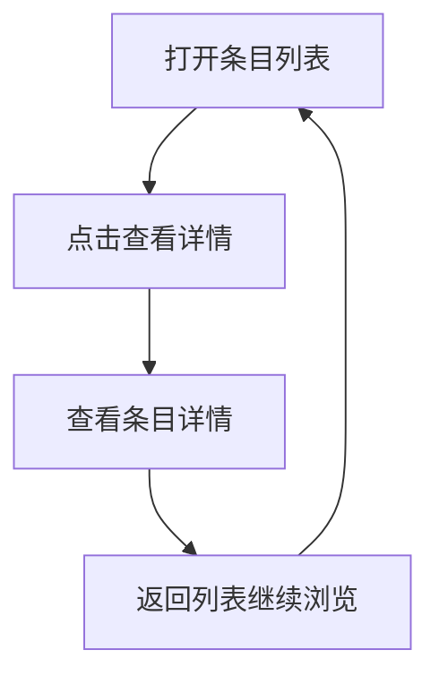
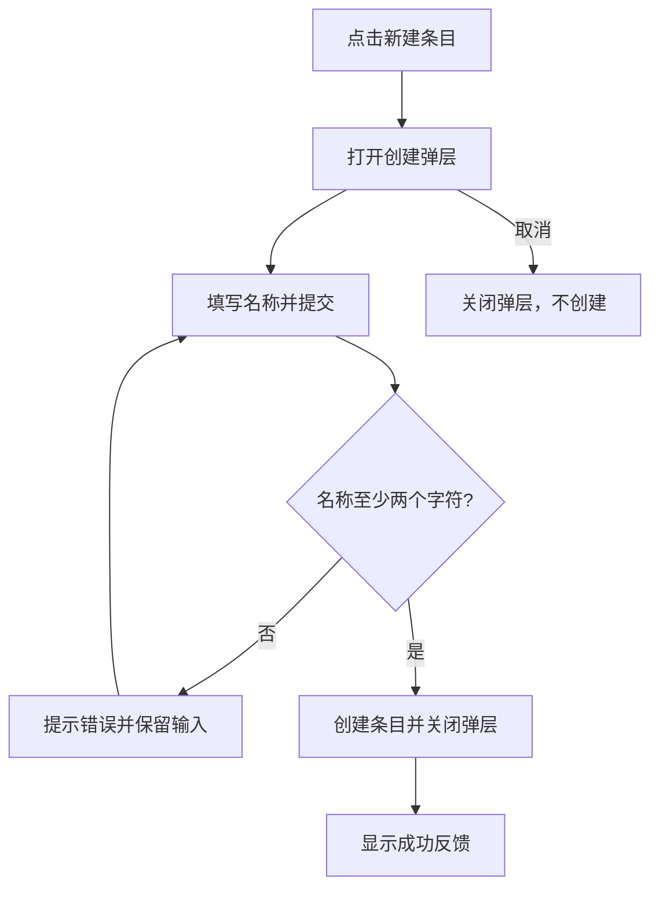
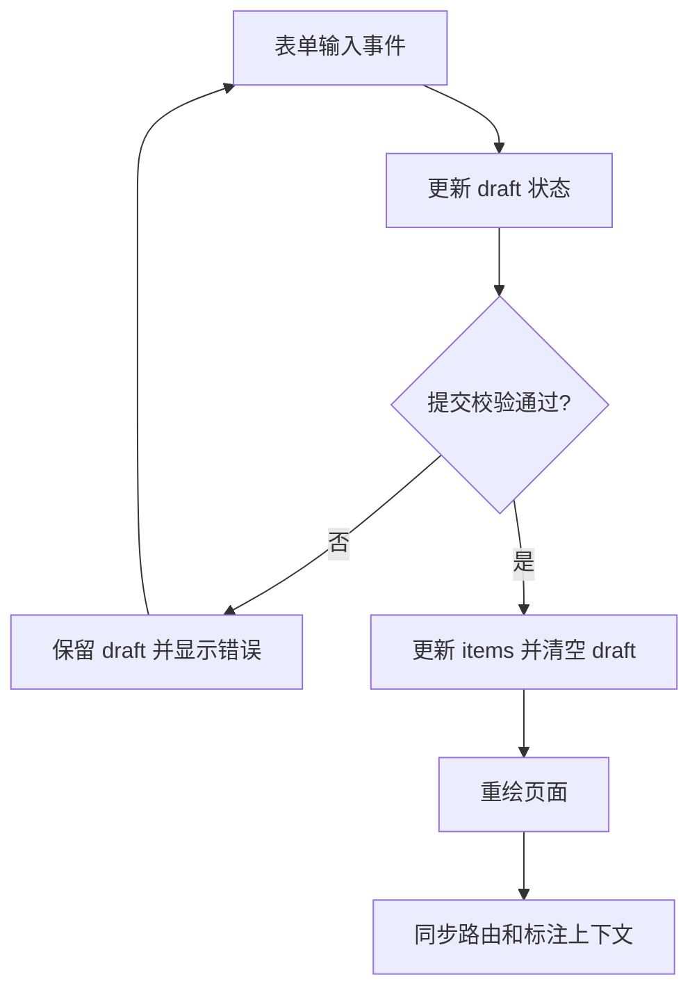

# 流程图

以下是演示流程，实际生成时依据项目已确认的业务规则绘制。点击“编辑”可直接修改下面的 Mermaid Markdown 节点、连线和文字说明，点击“预览”查看流程图。

## 业务流程

入口：普通用户打开条目列表。用户点击示例条目进入详情，查看完通过返回列表继续浏览。这是查看流程，不修改数据；真实项目的访问权限和失败处理待确认。

## 核心功能流程

入口：用户在列表点击新建条目。弹层打开后填写名称。名称为空或不足两个字符时，系统提示错误并保留输入；用户修改后可以重新提交。校验通过后创建条目、关闭弹层并显示成功反馈。点击取消只关闭弹层。

## 数据实时流

数据来源是表单输入。输入事件更新 draft；提交成功后更新 items 并清空 draft，再触发界面重绘。页面路由和标注上下文的变化会通知评审容器。这里演示前端状态更新，不连接后端实时服务；实际项目中的网络失败处理待确认。

