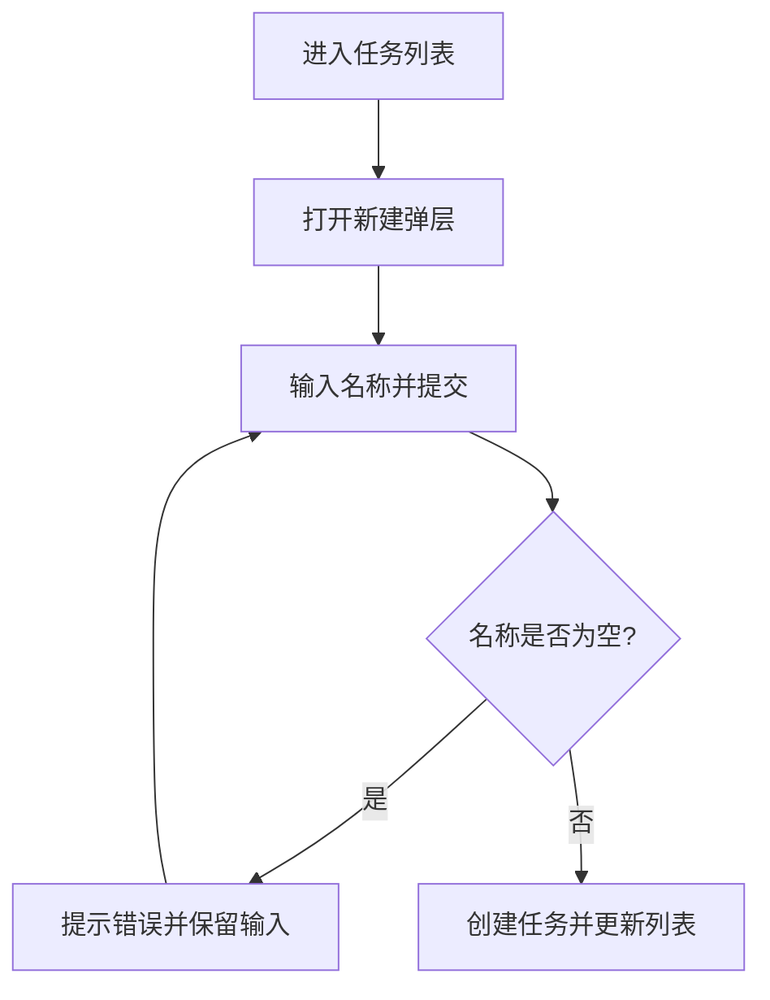
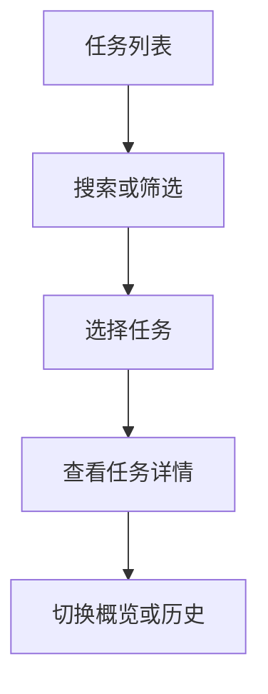

# 流程图

## 业务流程

入口：成员进入任务列表。角色：团队成员。

1. 查看任务列表，点击新建任务。
2. 输入任务名称，提交后校验必填项。
3. 名称为空则提示错误并保留输入；通过则创建任务并更新列表。

结果：新任务显示在列表中。失败后可在弹层内修改并重新提交。

## 核心功能流程

任务列表支持搜索、筛选和排序；选择任务后进入详情，可以切换概览与历史标签。详情记录由任务 ID 定位。

## 数据流

此演示使用浏览器内的原型数据。提交成功后更新同一任务数组，再重绘列表；没有接入服务器实时推送。真实项目的数据源、推送触发、断线及重试规则待确认。

