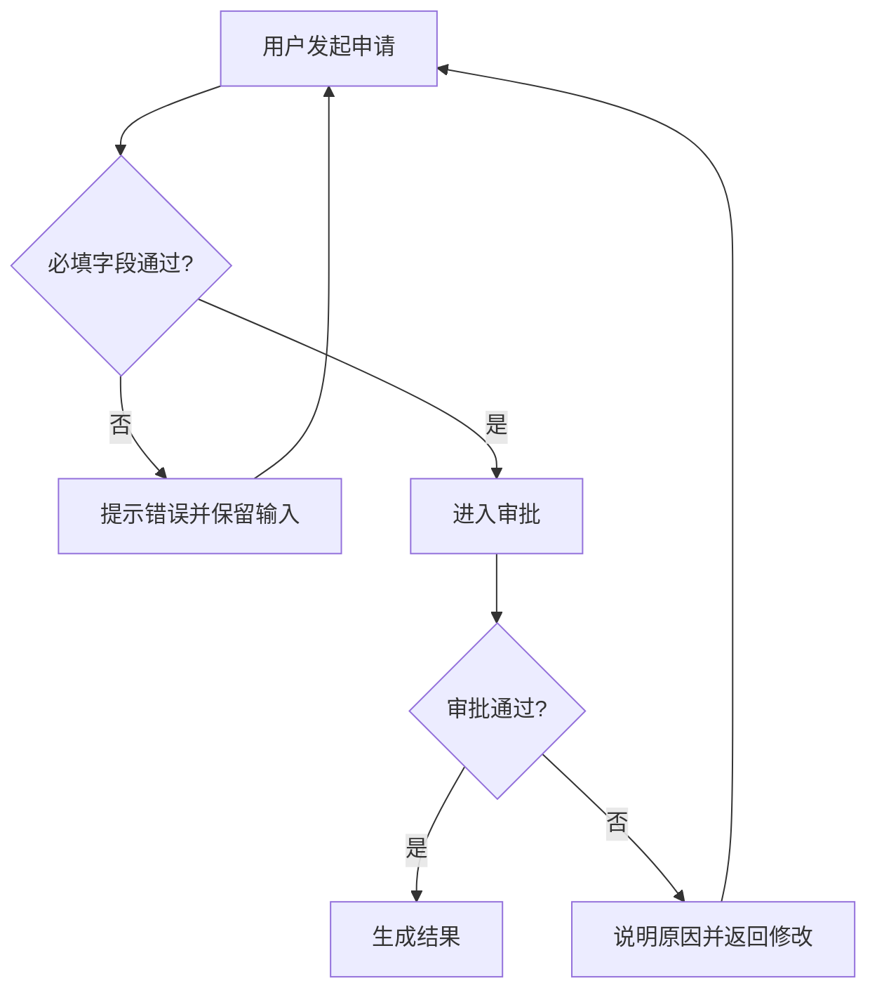

# 编辑、磁盘写回与开发页面导出

## 评审容器约定

沿用 assets/container-template.html 和 build-container.py；不重新手写容器，避免生成时遗漏编辑和导出能力。

- 保持模式按钮原有“三栏评审 ↔ 浮动标注”行为及目标模式文字；其后依次保留关闭/开启产品说明、关闭/开启页面标注、下载全部页面。
- 左右栏开关独立生效，隐藏对应分隔条，原型占据释放的空间。
- 每条标注右上角有编辑按钮。标题、Markdown 正文、每行一条的业务规则自动保存；ID、order、scope、锚点保持原值。正文可粘贴图片，也可编辑或删除图片 Markdown 引用。
- 编辑结果同步到 AnnotationRuntime，卡片与原型详情共享同一数据。
- 产品概述后的“流程图”章节与其他文档共用预览/编辑能力。提供业务流程、核心功能流程和实时数据流；每张图配套可编辑的文字描述，包含入口、角色、按顺序的步骤、分支条件、异常/回退和结果，便于独立理解。数据流额外说明来源、方向、更新触发及失败处理；“实时”描述数据流的业务性质，不宣称静态图片自动接入实时系统。

## 说明栏目与流程图查看

- 保留产品概述、流程图、功能需求、角色权限、业务规则、待确认与决策、数据与发布；材料缺失时显示待补充，不隐藏对应栏目。
- 从对应 Markdown 标题或业务规则加粗块抽取本栏内容；嵌套在功能需求中的规则仍须在业务规则栏显示。栏目内容可编辑并随评审副本保存。
- 在流程图栏目点击渲染图或补充图片进入全屏查看，滚轮缩放范围 25%–800%，适应屏幕按钮恢复默认视图；关闭或 Esc 退出。
- 下载图片导出 PNG，保持原图比例、白色背景和文字可读性；缩放仅影响查看，不改变下载分辨率或 Mermaid 源码。全屏弹层和派生图片不写入永久状态。

## 磁盘持久化

首次点击“授权自动写回”，在支持 File System Access API 的浏览器（建议桌面 Chrome/Edge）中选择当前 HTML 文件，或者新 HTML 副本。授权后停止输入约 320 ms 自动写回；写入串行执行，文件中内嵌全部文档、标注和图片。

- IndexedDB 仅作草稿恢复与保存句柄，不能冒充“永久保存”。真正持久化的验收对象是所选磁盘 HTML 文件。
- 浏览器重新打开后检查写入权限，权限仍有效则继续自动写回；失效时显示“重新授权写回”。不得在没有用户手势时反复弹授权框。
- 仅在写入流关闭成功后显示“已自动写回”；权限取消、拒绝、磁盘写入失败必须保持明确状态。修改未写回时关闭页面提示。
- 文件内嵌状态和浏览器草稿按保存时间取较新者；复制到其他路径或电脑时仍可从 HTML 内嵌数据恢复。
- 不支持 API 的浏览器只能下载完整评审副本；提示切换支持的浏览器才能自动写回，不能宣称已满足自动写回。
- 如果用户选择新副本，之后写入目标就是该副本，不会同时更新原文件。顶部显示文件名便于确认。

## 构建与源文件边界

标准入口仍为 `build-review.py visual-prd.project.json`。三种模式均支持可选 `inputs.flows: "flows.md"`，构建器将它复制到输出目录并内嵌到评审 HTML。旧入口 `build-container.py --flows flows.md` 和生成入口 `build-project.py --flows flows.md` 仍可使用。

浏览器评审编辑和磁盘写回保存完整 HTML 副本，不反向修改 PRD、产品模型、标注 JSON 或流程图 Markdown 源文件；正式需求变更仍需更新对应源文件并重建。界面规范修改也随评审副本保存，但正式配置回写继续使用新版的 JSON 导出与重建路径。

## 流程图输入

构建命令增加 `--flows flows.md`。Markdown 例子：

````markdown
# 流程图

## 业务流程

入口：用户进入列表。角色：普通用户。

1. 用户发起申请，系统检查必填字段。
2. 校验通过后进入审批；失败则提示错误并保留输入。
3. 审批通过后生成结果；拒绝时返回修改并重新申请。



结果、权限限制和实际分支依据项目需求填写；未知内容标待确认。
````

使用 `mermaid` 围栏代码块作为可编辑流程图的源数据，可直接修改节点名称、`-->` 连线、`|条件|` 分支和 `%%` 注释；不要以 base64 图片串代替这些源码。文字描述与图一起编辑和自动写回。业务流程、核心功能流程与数据流分别配套说明，不补造实际项目尚未确认的规则。

容器内联 assets/mermaid.min.js（Mermaid 11.16.0，来自官方 npm 包，许可见 assets/mermaid-LICENSE.txt），无需联网或外部文件。预览渲染为 SVG，编辑区和 HTML 内嵌状态始终保留原始 Markdown；渲染失败时显示提示与源码。切换章节或重新输入后忽略过期的渲染结果，避免旧图覆盖新内容。补充图片仍可直接粘贴。

## 开发导出边界

- 生成模式使用稳定的 `data-page` 与可选 `data-page-label`，全部页面在初始化 DOM 中注册，包括未访问的详情页；使用原有 `window.__proto` 路由。单页增强模式可直接导出现有 HTML，保留自身交互和路由。已有多页 HTML 须提供能枚举全部页面及导航的适配协议；无法从单文件取得的外部页面、Axure 多文件入口不能假称已经全部下载。
- build-container.py 从原始原型源码去除标注运行时和标注初始化两个 script、data-anno 系列属性，再内联业务 prototype-runtime.js；评审容器内保存独立的开发源码 payload。
- 标注相关脚本保持模板中独立 script 的结构，业务代码不要与标注脚本混写。业务跳转和事件不要依赖 data-anno；该属性仅用于评审锚点。
- “下载”生成一个 HTML，以当前页面为默认入口；“下载全部页面”生成离线 ZIP，内含每页一个 HTML，以序号和稳定页面 ID 命名。
- 每个 HTML 保留全部共享页面定义、样式、业务处理器和必要资源，确保跨页面导航可用；不同文件的默认入口不同。无需后端即可演示交互，业务数据仍为原型数据。
- 导出从源码重新生成，不序列化 iframe 的当前 DOM，避免表单当前状态、临时弹层或事件监听丢失导致不可用。
- 下载不含产品说明、流程图文档、右侧标注、圆点和标注 runtime；这些内容只在完整评审 HTML 中保存。

验收：下载 ZIP，检查 CRC 与文件数；在新浏览器上下文离线打开每页入口，实际操作跳转、返回、弹层、表单输入、校验和提交。含外部资源的源码先内联再交付。
